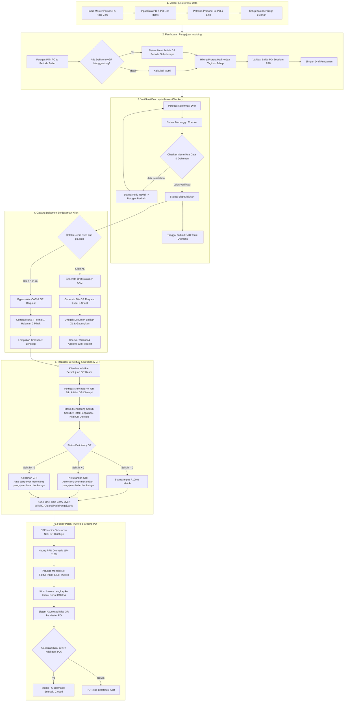
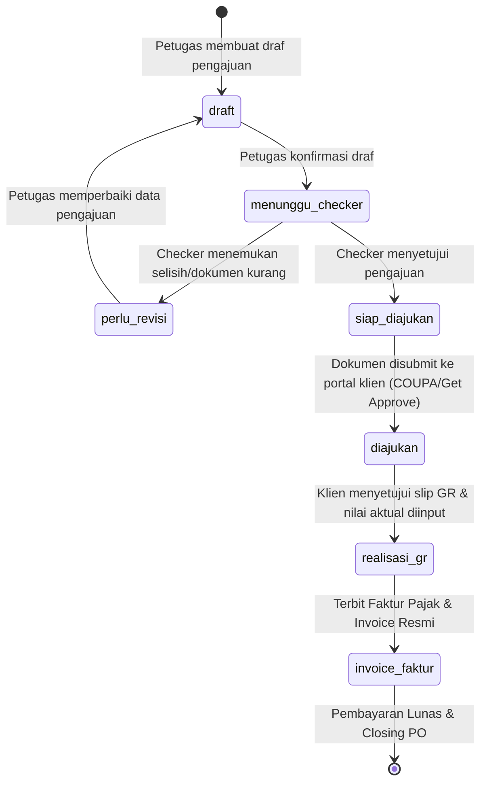

# INVORA (Invoice Operations & Revenue Assurance)

[](https://nextjs.org/)
[](https://react.dev/)
[](https://www.typescriptlang.org/)
[](https://orm.drizzle.team/)
[](https://supabase.com/)
[]()

Sistem enterprise internal **PT IDStar Cipta Teknologi** yang dirancang khusus untuk mengelola seluruh siklus hidup penagihan (*invoicing*), rekonsiliasi hari kerja talenta (*timesheet*), penerbitan berkas BAST/CAC resmi, pertukaran paket *Goods Receipt (GR) Request* multi-sheet dengan klien (khususnya XL Smart dan Non-XL), penanganan selisih persetujuan (*Deficiency GR*), hingga penerbitan Faktur Pajak, Invoice Resmi, dan penutupan *Purchase Order (PO)* otomatis.

---

## Daftar Isi
1. [Latar Belakang & Masalah Bisnis](#1-latar-belakang--masalah-bisnis)
2. [Peran Pengguna & Hak Akses (RBAC)](#2-peran-pengguna--hak-akses-rbac)
3. [Arsitektur Diagram Alur Utama (End-to-End Flow)](#3-arsitektur-diagram-alur-utama-end-to-end-flow)
4. [Siklus Status Pengajuan (State Machine)](#4-siklus-status-pengajuan-state-machine)
5. [Detail Alur Proses Operasional](#5-detail-alur-proses-operasional)
   - [Tahap 1: Pengelolaan Data Master & Referensi](#tahap-1-pengelolaan-data-master--referensi)
   - [Tahap 2: Pembuatan Draf Pengajuan & Mesin Hitung Otomatis](#tahap-2-pembuatan-draf-pengajuan--mesin-hitung-otomatis)
   - [Tahap 3: Verifikasi Dua Lapis (Maker-Checker Workflow)](#tahap-3-verifikasi-dua-lapis-maker-checker-workflow)
   - [Tahap 4: Percabangan Proses Berdasarkan Klien (XL vs Non-XL)](#tahap-4-percabangan-proses-berdasarkan-klien-xl-vs-non-xl)
   - [Tahap 5: Pencatatan GR Aktual & Mesin Deficiency GR](#tahap-5-pencatatan-gr-aktual--mesin-deficiency-gr)
   - [Tahap 6: Penerbitan Invoice Resmi & Faktur Pajak](#tahap-6-penerbitan-invoice-resmi--faktur-pajak)
   - [Tahap 7: Kontrol Penyelesaian PO (Closing PO) & Rekonsiliasi](#tahap-7-kontrol-penyelesaian-po-closing-po--rekonsiliasi)
6. [Teknologi & Arsitektur Sistem](#6-teknologi--arsitektur-sistem)
7. [Struktur Direktori Proyek](#7-struktur-direktori-proyek)
8. [Panduan Instalasi & Menjalankan Aplikasi](#8-panduan-instalasi--menjalankan-aplikasi)
9. [Dataset Pengujian & Hasil Validasi UAT](#9-dataset-pengujian--hasil-validasi-uat)

---

## 1. Latar Belakang & Masalah Bisnis

PT IDStar Cipta Teknologi menempatkan puluhan hingga ratusan talenta IT profesional di berbagai klien enterprise (telekomunikasi, perbankan, konglomerasi). Sebelumnya, proses penagihan bulanan menghadapi berbagai tantangan operasional:

| Tantangan Sebelumnya | Solusi INVORA |
|---|---|
| **Human Error Prorata Hari Kerja:** Talenta bergabung atau keluar di tengah bulan rentan salah hitung hari kerja tagihan akibat variasi hari libur/cuti bersama. | **Working Day Engine Otomatis:** Terintegrasi kalender kerja resmi Indonesia & IDStar. Menghitung prorata presisi tanpa pembulatan liar menggunakan pustaka `decimal.js`. |
| **Ketiadaan Pemisahan Tugas (*Segregation of Duties*):** Satu orang bisa membuat dan menyetujui draf tagihan sekaligus, menimbulkan risiko tata kelola (GCG). | **Maker-Checker Enforced by Server:** Pembuat draf (*Petugas*) secara sistemik dilarang menyetujui pengajuannya sendiri. Hanya akun *Checker* yang memiliki wewenang approval/revisi. |
| **Kelebihan Tagihan Lintas PO (*Cross-PO*):** Nilai tagihan talenta yang melampaui sisa plafon PO aktif harus dipilah secara manual. | **Alur Cross-PO Otomatis:** Sistem mendeteksi sisa saldo PO utama, menagihkan sisa maksimal, lalu mengalokasikan kelebihan tagihan ke PO penerus secara berantai. |
| **Paket GR Request XL yang Rumit:** Klien XL mewajibkan format file Excel 3-sheet (*Vendor, SOW, COVER*) dengan alur revisi bolak-balik. | **Automated Excel Package Engine:** Men-generate sheet Vendor otomatis via `exceljs`, menyediakan form unggah balikan XL, merge cerdas, serta riwayat versi. |
| **Format Dokumen Multi-Klien Berbeda:** Klien Non-XL (Bank Mandiri, Telkomsel, Astra) memerlukan BAST formal 2 pihak, bukan berkas CAC internal XL. | **Multi-Client Routing:** Deteksi otomatis tipe klien dari data PO. Non-XL langsung diarahkan ke generator BAST 1 halaman dua pihak resmi siap tanda tangan. |
| **Deficiency GR (Persetujuan Parsial Klien):** Klien menyetujui nilai GR lebih kecil dari pengajuan, dan selisihnya rawan lupa/terklaim ganda (*double-claim*). | **Deficiency GR Engine with One-Time Carry-Over:** Menghitung selisih persetujuan otomatis, mengunci kompensasi tepat satu kali ke penagihan bulan berikutnya. |
| **Akses Akun Non-Korporat:** Risiko kebocoran data finansial dan kontrak kerja. | **Google SSO Domain Lockdown:** Otentikasi terpusat yang dibatasi secara ketat hanya untuk email resmi `@idstar.group`. |

---

## 2. Peran Pengguna & Hak Akses (RBAC)

Sistem menerapkan prinsip pemisahan wewenang (*Segregation of Duties*):

```
       [ Super Admin ]
              │ (Kelola Pengguna, Data Master, Kalender Kerja, Audit Trail)
              ▼
    [ Petugas (Maker) ] ──────────────► [ Checker (Reviewer) ]
  • Input Data Referensi & PO           • Verifikasi kalkulasi & dokumen
  • Buat Draf Pengajuan & Prorata       • Approve / Return (Minta Revisi)
  • Unggah Timesheet & Dokumen          • Validasi Paket GR Request XL
  • Input Realisasi GR & Faktur Pajak   • Dilarang mengedit angka langsung
  (Dilarang approve pengajuan sendiri)
```

| Role | Tanggung Jawab Utama | Batasan & Pengamanan |
| :--- | :--- | :--- |
| **Super Admin** | Manajemen akun pengguna, konfigurasi perusahaan, master kalender kerja, dan audit trail sistem. | Memiliki akses menyeluruh untuk konfigurasi data referensi. |
| **Petugas (Maker)** | Input master data, membuat draf pengajuan, unggah timesheet, generate dokumen CAC/BAST, input nomor slip GR & faktur pajak. | **Dilarang keras menyetujui pengajuannya sendiri.** Tombol konfirmasi draf hanya memindahkan status ke antrean Checker. |
| **Checker (Reviewer)** | Melakukan audit kelengkapan dokumen, memvalidasi hari kerja & rate, menyetujui/mengembalikan pengajuan, validasi file GR Request. | **Tidak dapat mengubah nominal langsung** tanpa meminta revisi dari Petugas pembuat draf. |

---

## 3. Arsitektur Diagram Alur Utama (End-to-End Flow)



---

## 4. Siklus Status Pengajuan (State Machine)

Perubahan status pengajuan dikendalikan oleh aturan transisi ketat:



---

## 5. Detail Alur Proses Operasional

### Tahap 1: Pengelolaan Data Master & Referensi
Sebelum proses penagihan berjalan, sistem menyiapkan data dasar yang terstruktur:
1. **Master PO (Purchase Order) & PO Line Items:**
   - Menyimpan nomor kontrak PO, nama proyek, tahun anggaran, pagu item sebelum PPN (`nilaiItem`), sisa saldo plafon (`saldoSebelumPpn`), nama klien, dan jenis tagihan (`bulanan` vs `tahap`).
   - Line Items memecah lingkup pekerjaan berdasarkan spesialisasi (misal: *Senior Backend Java*, *QA Automation*, dll).
2. **Master Personel & Rate Card:**
   - Menyimpan profil talenta dan riwayat tarif bulanan/harian beserta masa berlaku kontrak (`berlakuDari` s/d `berlakuSampai`).
3. **Pemetaan Personel ke PO:** Menautkan personel aktif dengan baris PO yang relevan.
4. **Master Kalender Kerja:** Menentukan jumlah hari kerja acuan bulanan setelah dipotong akhir pekan, libur nasional, dan cuti bersama resmi.

### Tahap 2: Pembuatan Draf Pengajuan & Mesin Hitung Otomatis
Petugas memilih nomor PO dan periode bulan penagihan (format `YYYY-MM`). Sistem memproses perhitungan di balik layar:

* **A. Tagihan Bulanan (Prorata Hari Kerja):**
  $$\text{Nilai Tagihan} = \left(\frac{\text{Hari Kerja Ditagihkan}}{\text{Hari Kerja Acuan Bulan}}\right) \times \text{Rate Bulanan}$$
  *Hari kerja dapat bersumber langsung dari upload timesheet absensi atau kalkulasi kalender kontrak.*

* **B. Tagihan Berbasis Tahap (Milestone):**
  Untuk kontrak berbasis deliverable/termin, petugas mengisi nominal penagihan secara manual disertai keterangan milestone (misal: `"Tahap I - Penyelesaian 50% UAT"`).

* **C. Alokasi Lintas PO (*Cross-PO Allocation*):**
  Bila sisa pagu PO pertama tidak mencukupi untuk membayar tagihan penuh personel:
  1. Sistem otomatis menagihkan sisa pagu maksimal pada PO pertama.
  2. Sisa tagihan yang belum tertampung ditandai untuk dialokasikan ke PO penerus pada periode yang sama.

* **D. Deteksi Deficiency GR Menggantung:**
  Sistem otomatis memeriksa apakah terdapat selisih potongan GR dari bulan sebelumnya yang belum terserap. Jika ada, sistem langsung menampilkan banner peringatan dan memperhitungkan selisih tersebut ke dalam draf.

### Tahap 3: Verifikasi Dua Lapis (Maker-Checker Workflow)
1. **Konfirmasi Petugas:** Petugas memeriksa kesesuaian rincian, lalu menekan tombol konfirmasi. Status berubah menjadi `menunggu_checker`.
2. **Review oleh Checker:**
   - Checker melakukan audit atas hari kerja, rate card, dokumen lampiran, dan ketersediaan pagu PO.
   - **Tindakan:**
     - **Minta Revisi (`perlu_revisi`):** Checker wajib mengisi catatan perbaikan. Status kembali ke draf agar Petugas dapat memperbaiki data.
     - **Setujui (`siap_diajukan`):** Pengajuan disahkan. Sistem otomatis mengisi stempel waktu `tanggalSubmitCac`.

### Tahap 4: Percabangan Proses Berdasarkan Klien (XL vs Non-XL)
Sistem secara cerdas mendeteksi kolom `po.klien`:

* **Jalur A: Klien XL (Alur CAC & GR Request COUPA):**
  1. Generate dokumen CAC (Customer Acceptance Certificate) format standar XL.
  2. Generate file spreadsheet Excel GR Request 3-sheet (*Vendor, SOW, COVER*).
  3. Siklus balikan: unggah file revisi dari tim XL, lakukan penggabungan otomatis (*merge*), dan Checker memvalidasi hasil akhir.
  4. Kolom nomor invoice dikunci rapat hingga Checker meloloskan tahap GR Request.

* **Jalur B: Klien Non-XL (BAST Formal 1 Lembar 2 Pihak):**
  1. Melewati langkah CAC dan format Excel GR XL.
  2. Generate dokumen BAST formal 1 halaman lengkap dengan klausul hukum dua pihak:
     - **Pihak Pertama:** Penyedia jasa (PT IDStar Cipta Teknologi).
     - **Pihak Kedua:** Klien penerima jasa (nama instansi, alamat, pejabat berwenang).
  3. Dokumen siap dicetak dalam format PDF resmi dengan rincian talenta dan kolom tanda tangan kedua pihak.
  4. Indikator peringatan visual muncul di dashboard jika berkas BAST belum diunduh/ditandatangani.

### Tahap 5: Pencatatan GR Aktual & Mesin Deficiency GR
Setelah berkas diajukan, klien memproses persetujuan Goods Receipt (GR) resmi:
1. **Input Realisasi GR:** Petugas memasukkan nomor GR Slip (`nomorGrSlip`), tanggal persetujuan, dan nominal riil yang disetujui klien (`nilaiGrDisetujui`) sebelum PPN.
2. **Evaluasi Selisih (*Deficiency GR*):**
   $$\text{Selisih GR} = \text{Total Tagihan Pengajuan} - \text{Nilai GR Disetujui}$$
   - **Impas (`0.00`):** Nilai GR disetujui sama persis dengan pengajuan (100% match).
   - **Kekurangan GR ($> 0$):** Klien menyetujui lebih kecil dari tagihan. Nilai selisih positif otomatis di-carry over untuk **menambah** tagihan pengajuan berikutnya.
   - **Kelebihan GR ($< 0$):** Klien menyetujui lebih besar. Nilai selisih negatif otomatis di-carry over untuk **memotong** tagihan pengajuan berikutnya.
3. **Jaminan One-Time Carry-Over:** Kolom `selisihGrDipakaiPadaPengajuanId` mengunci relasi antar-pengajuan sehingga selisih tidak akan pernah terkompensasi lebih dari satu kali dalam audit keuangan.

### Tahap 6: Penerbitan Invoice Resmi & Faktur Pajak
1. **Penguncian Dasar Pengenaan Pajak (DPP):** Sesuai regulasi perpajakan dan aturan penagihan korporat: **Nilai DPP Invoice sebelum PPN wajib sama persis dengan Nilai GR yang Disetujui**.
2. **Perhitungan PPN Otomatis:** Mendukung tarif PPN 11% (UU HPP) maupun 12% (penyesuaian baru).
   $$\text{PPN} = \text{DPP} \times \text{Tarif PPN}$$
   $$\text{Total Tagihan Akhir} = \text{DPP} + \text{PPN}$$
3. **Pencatatan Dokumen:** Petugas menginput nomor e-Faktur Pajak resmi dari DJP dan nomor invoice resmi perusahaan.

### Tahap 7: Kontrol Penyelesaian PO (Closing PO) & Rekonsiliasi
1. **Akumulasi Realisasi Nilai GR:** Sistem memperbarui total kumulatif serapan dana pada tabel PO (`po.nilaiGr`).
2. **Otomatisasi Status Closing PO:**
   $$\text{Jika } \sum \text{Nilai GR Disetujui} \ge \text{Nilai Item PO} \longrightarrow \text{Status PO: Selesai (Closed)}$$
   *Bila pagu belum habis terserap, PO tetap berstatus Aktif untuk periode penagihan berikutnya.*
3. **Dashboard & Monitoring:**
   - **Summary PO (`/summary-po`):** Memantau pagu, serapan realisasi, dan sisa plafon per tahun anggaran secara real-time.
   - **Analisa Durasi Invoicing (`/dashboard/analisa-durasi`):** Melacak rata-rata durasi siklus penagihan (CAC disetujui $\rightarrow$ GR disetujui $\rightarrow$ Invoice lunas).
   - **Rekon Invoice (`/api/rekon-invoice`):** Rekapitulasi status penagihan internal untuk rekonsiliasi akuntansi bulanan.

---

## 6. Teknologi & Arsitektur Sistem

```
+-------------------------------------------------------------------------+
|                               FRONTEND                                  |
|   Next.js 16 (App Router, Turbopack) + React 19                         |
|   Komponen: StatusProsesForm, BastNonXlView, SummaryPO, PengajuanClient |
|   Styling: Modern CSS & Tailwind CSS                                    |
+-------------------------------------------------------------------------+
                                    │
                                    ▼
+-------------------------------------------------------------------------+
|                               BACKEND                                   |
|   Next.js Server Actions & Route Handlers (TypeScript 5)                |
|   Business Logic: src/lib/deficiency-gr.ts, klien.ts, google-auth.ts    |
|   Document Engines: pdf-lib (Stamping/PDF) + exceljs (Spreadsheet)      |
|   Financial Precision: decimal.js                                       |
+-------------------------------------------------------------------------+
                                    │
                                    ▼
+-------------------------------------------------------------------------+
|                            DATABASE LAYER                               |
|   Drizzle ORM 0.45.2 (Type-safe schema & migrations)                    |
|   PostgreSQL on Supabase Cloud (Row-Level Security / RLS terpasang)    |
+-------------------------------------------------------------------------+
```

### Rincian Dependensi Utama:
- **Framework:** Next.js 16.3.5 (App Router, React Server Components)
- **Library UI:** React 19.2.8 & Lucide Icons
- **Database & ORM:** PostgreSQL (Supabase) dengan Drizzle ORM 0.45.2 & driver `postgres`
- **Kalkulasi Finansial:** `decimal.js` untuk menjamin kalkulasi moneter bebas dari galat floating point
- **Pengolahan Dokumen:**
  - `pdf-lib`: Komposisi dan stamping PDF resmi BAST 2 pihak dan draf CAC
  - `exceljs`: Pembuatan dan manipulasi template spreadsheet GR Request 3-sheet (*Vendor, SOW, COVER*)
- **Keamanan & Otentikasi:** Kredensial lokal terenkripsi `bcryptjs` + Google Workspace OAuth2 dengan validasi domain khusus `@idstar.group`

---

## 7. Struktur Direktori Proyek

```
proses-invoicing-app/
├── drizzle/                      # Berkas migrasi database SQL (Drizzle Kit)
├── public/                       # Aset statis & logo perusahaan
├── scripts/                      # Skrip operasional, migrasi, dan data seed
│   ├── seed-data-bervariasi.ts   # Seeding data dummy komprehensif (8 PO, 16 talenta, 13 pengajuan)
│   ├── ganti-sandi.ts            # Utilitas reset password akun pengguna
│   └── generate-validation-excel.js # Generator berkas evaluasi UAT
├── src/
│   ├── app/                      # Next.js App Router
│   │   ├── api/                  # REST API Route Handlers
│   │   │   ├── auth/             # Otentikasi (login, logout, session, google-callback)
│   │   │   ├── pengajuan/        # API workflow pengajuan, CAC, GR Request, lampiran
│   │   │   ├── rekon-invoice/    # Ekspor laporan rekon invoice
│   │   │   └── summary-po/       # Endpoint data summary pagu PO
│   │   ├── akun/                 # Halaman manajemen akun & hak akses
│   │   ├── dashboard/            # Analisa durasi & metrik invoicing
│   │   ├── data-referensi/       # Kelola Master PO, Personel, Rate Card, Kalender, Klien
│   │   ├── kelola-data/          # Impor massal data master & tracker
│   │   ├── login/                # Halaman login modern dengan Google SSO
│   │   ├── pengajuan/            # Modul utama draf, review Checker, BAST, dan GR Request
│   │   └── summary-po/           # Dashboard visual pagu dan sisa saldo PO
│   ├── components/               # Komponen UI bersama (Topbar, Footer, Select, Modals)
│   ├── db/                       # Konfigurasi Drizzle ORM & skema database
│   │   ├── index.ts              # Koneksi client database postgres
│   │   └── schema.ts             # Definisi skema tabel & relasi PostgreSQL
│   └── lib/                      # Core business logic
│       ├── deficiency-gr.ts      # Engine kalkulasi selisih GR & carry-over
│       ├── deficiency-gr-server.ts # Server logic deficiency GR
│       ├── google-auth.ts        # Validasi Google Workspace OAuth SSO (@idstar.group)
│       ├── gr-request-excel.ts   # Generator paket spreadsheet Excel GR Request 3-sheet
│       ├── hitung-pengajuan.ts   # Mesin hitung prorata hari kerja & tagihan tahap
│       ├── kalender.ts           # Logika hari kerja & kalender libur nasional
│       ├── klien.ts              # Deteksi routing klien XL vs Non-XL
│       ├── perhitungan.ts        # Utilitas kalkulasi moneter dengan Decimal.js
│       └── require-role.ts       # Middleware proteksi peran (RBAC)
├── .gitignore                    # Aturan proteksi file rahasia & filter dokumen
├── drizzle.config.ts             # Konfigurasi Drizzle Kit
├── next.config.ts                # Konfigurasi Next.js
├── package.json                  # Manifest dependensi & skrip Node.js
└── README.md                     # Dokumentasi komprehensif proyek (file ini)
```

---

## 8. Panduan Instalasi & Menjalankan Aplikasi

### Prasyarat:
- **Node.js:** Versi 20.x atau lebih baru
- **Package Manager:** `npm`, `pnpm`, atau `yarn`
- **Database:** PostgreSQL (disarankan instans Supabase)

### 1. Kloning Repositori & Instalasi Dependensi
```bash
git clone https://github.com/imamfatah-idstar/Invora.git
cd Invora
npm install
```

### 2. Konfigurasi Environment Variables
Buat file `.env` di direktori *root* (gunakan `.env.example` sebagai referensi):
```env
# Database Connection (Supabase PostgreSQL)
DATABASE_URL="postgresql://postgres:[PASSWORD]@[HOST]:[PORT]/postgres?sslmode=require"

# Session Security
SESSION_SECRET="your-ultra-secure-random-secret-key-32-chars-min"

# Google Workspace SSO (Opsional untuk login Google)
GOOGLE_CLIENT_ID="your-client-id.apps.googleusercontent.com"
GOOGLE_CLIENT_SECRET="your-client-secret"
GOOGLE_REDIRECT_URI="http://localhost:3000/api/auth/google/callback"
```

### 3. Migrasi Skema Basis Data
Sinkronisasikan definisi skema TypeScript ke database PostgreSQL:
```bash
npx drizzle-kit push
```

### 4. Seeding Data Dummy Pengujian (Opsional)
Jalankan skrip *seed* untuk mengisi database dengan dataset variatif realistis:
```bash
npx tsx scripts/seed-data-bervariasi.ts
```

### 5. Menjalankan Server Development
```bash
npm run dev
```
Buka browser di [http://localhost:3000](http://localhost:3000).

### Akun Uji Coba Default (Setelah Seeding):
- **Super Admin:** `admin@idstar.group` (Password: `Admin123!`)
- **Petugas (Maker):** `petugas@idstar.group` (Password: `Petugas123!`)
- **Checker (Reviewer):** `checker@idstar.group` (Password: `Checker123!`)

---

## 9. Dataset Pengujian & Hasil Validasi UAT

Aplikasi telah melalui pengujian komprehensif (*User Acceptance Testing*) bersama tim Finance & Legal:

- **25 Skenario UAT Lengkap:** Menguji Google SSO `@idstar.group`, penegakan *Segregation of Duties*, prorata masuk/keluar tengah bulan, alokasi *Cross-PO* berantai, siklus bolak-balik Excel GR XL 3-sheet, BAST formal Non-XL dua pihak, mesin *Deficiency GR*, hingga penutupan PO otomatis.
- **Tingkat Kelulusan:** 100% Lolos (**25/25 Pass, 0 Defect**).
- **Efisiensi Waktu Operasional:** Memangkas durasi penyiapan dokumen penagihan dari **3–5 hari kerja (32 jam)** menjadi **kurang dari 30 menit (efisiensi 96.9%)**.
- **Tingkat Akurasi Finansial:** Menghilangkan insiden salah hitung prorata dan salah alokasi pagu PO dari 5–8% menjadi **0% (*Zero Calculation Error*)**.
- **Skor Kepuasan Pengguna:** **4.95 / 5.0 (Sangat Puas)** pada evaluasi UAT tim Finance & Invoicing PT IDStar Cipta Teknologi.

---

## Hak Cipta & Kepemilikan
Sistem ini dikembangkan secara eksklusif untuk kepentingan operasional internal **PT IDStar Cipta Teknologi**. Seluruh hak kekayaan intelektual, logika bisnis, dan tata kelola penagihan dilindungi.
