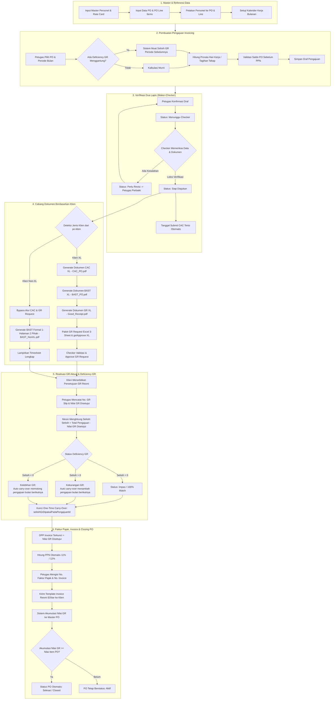
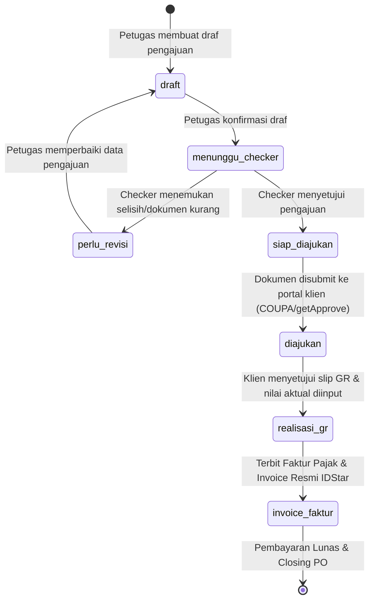

# INVORA (Invoice Operations & Revenue Assurance)

[](https://react.dev/)
[](https://www.typescriptlang.org/)
[](https://orm.drizzle.team/)
[](https://supabase.com/)
[]()

Sistem enterprise internal **PT IDStar Cipta Teknologi** yang dirancang khusus untuk mengelola seluruh siklus hidup penagihan (*invoicing*), rekonsiliasi hari kerja talenta (*timesheet*), penerbitan dokumen resmi **BAST (XL & Non-XL)**, **CAC XL**, dan **Good Receipt (GR) BAU Approval XL**, pertukaran paket *Goods Receipt (GR) Request* multi-sheet dengan klien via portal resmi getApprove XL, penanganan selisih persetujuan (*Deficiency GR*), hingga penerbitan Faktur Pajak, Invoice Resmi IDStar, dan penutupan *Purchase Order (PO)* otomatis.

---

## Daftar Isi
1. [Latar Belakang & Masalah Bisnis](#1-latar-belakang--masalah-bisnis)
2. [Peran Pengguna & Hak Akses (RBAC)](#2-peran-pengguna--hak-akses-rbac)
3. [Arsitektur Diagram Alur Utama (End-to-End Flow)](#3-arsitektur-diagram-alur-utama-end-to-end-flow)
4. [Siklus Status Pengajuan (State Machine)](#4-siklus-status-pengajuan-state-machine)
5. [Detail Alur Proses Operasional](#5-detail-alur-proses-operasional)
   - [Tahap 1: Pengelolaan Data Master & Referensi](#tahap-1-pengelolaan-data-master--referensi)
   - [Tahap 2: Pembuatan Draf Pengajuan & Mesin Hitung Otomatis](#tahap-2-pembuatan-draf-pengajuan--mesin-hitung-otomatis)
   - [Tahap 3: Verifikasi Dua Lapis (Maker-Checker Workflow)](#tahap-3-verifikasi-dua-lapis-maker-checker-workflow)
   - [Tahap 4: Percabangan Dokumen Resmi Berdasarkan Klien](#tahap-4-percabangan-dokumen-resmi-berdasarkan-klien)
     - [A. BAST Khusus Non-XL (Sesuai `BAST_NonXL.pdf`)](#a-bast-khusus-non-xl-sesuai-bast_nonxlpdf)
     - [B. BAST & CAC Khusus XL (Sesuai `BAST_PO.pdf` & `CAC_PO.pdf`)](#b-bast--cac-khusus-xl-sesuai-bast_popdf--cac_popdf)
     - [C. Good Receipt (GR) Khusus XL (Sesuai `Good_Receipt.pdf`)](#c-good-receipt-gr-khusus-xl-sesuai-good_receiptpdf)
     - [D. Integrasi Portal Resmi getApprove XL](#d-integrasi-portal-resmi-getapprove-xl)
   - [Tahap 5: Pencatatan GR Aktual & Mesin Deficiency GR](#tahap-5-pencatatan-gr-aktual--mesin-deficiency-gr)
   - [Tahap 6: Penerbitan Invoice Resmi & Faktur Pajak](#tahap-6-penerbitan-invoice-resmi--faktur-pajak)
   - [Tahap 7: Kontrol Penyelesaian PO (Closing PO) & Rekonsiliasi](#tahap-7-kontrol-penyelesaian-po-closing-po--rekonsiliasi)
   - [Tahap 8: Dashboard Monitoring Outstanding Invoice & Aging Schedule](#tahap-8-dashboard-monitoring-outstanding-invoice--aging-schedule)
   - [Tahap 9: Modul Pencatatan Pelunasan (Payment Settlement)](#tahap-9-modul-pencatatan-pelunasan-payment-settlement)
6. [Teknologi & Arsitektur Sistem](#6-teknologi--arsitektur-sistem)
7. [Struktur Direktori Proyek](#7-struktur-direktori-proyek)
8. [Panduan Instalasi & Menjalankan Aplikasi](#8-panduan-instalasi--menjalankan-aplikasi)
9. [Dataset Pengujian & Hasil Validasi UAT](#9-dataset-pengujian--hasil-validasi-uat)

---

## 1. Latar Belakang & Masalah Bisnis

PT IDStar Cipta Teknologi menempatkan puluhan hingga ratusan talenta IT profesional di berbagai klien enterprise (telekomunikasi, perbankan, konglomerasi). Sebelumnya, proses penagihan bulanan menghadapi berbagai tantangan operasional:

| Tantangan Sebelumnya | Solusi INVORA |
|---|---|
| **Human Error Prorata Hari Kerja:** Talenta bergabung atau keluar di tengah bulan rentan salah hitung hari kerja tagihan akibat variasi hari libur/cuti bersama. | **Working Day Engine Otomatis:** Terintegrasi kalender kerja resmi Indonesia & IDStar. Menghitung prorata presisi tanpa pembulatan liar menggunakan pustaka `decimal.js`. |
| **Ketiadaan Pemisahan Tugas (*Segregation of Duties*):** Satu orang bisa membuat dan menyetujui draf tagihan sekaligus, menimbulkan risiko tata kelola (GCG). | **Maker-Checker Enforced by Server:** Pembuat draf (*Petugas*) secara sistemik dilarang menyetujui pengajuannya sendiri. Hanya akun *Checker* yang memiliki wewenang approval/revisi. |
| **Kelebihan Tagihan Lintas PO (*Cross-PO*):** Nilai tagihan talenta yang melampaui sisa plafon PO aktif harus dipilah secara manual. | **Alur Cross-PO Otomatis:** Sistem mendeteksi sisa saldo PO utama, menagihkan sisa maksimal, lalu mengalokasikan kelebihan tagihan ke PO penerus secara berantai. |
| **Paket GR Request XL yang Rumit:** Klien XL mewajibkan format file Excel 3-sheet (*Vendor, SOW, COVER*) dengan alur revisi bolak-balik. | **Automated Excel Package Engine:** Men-generate sheet Vendor otomatis via `exceljs`, menyediakan form unggah balikan XL, merge cerdas, serta riwayat versi. |
| **Format Dokumen Multi-Klien Berbeda:** Klien Non-XL (Bank CIMB Niaga, BCA, dll) memerlukan BAST formal 2 pihak, bukan berkas CAC internal XL. | **Multi-Client Routing:** Deteksi otomatis tipe klien dari data PO. Non-XL diarahkan ke generator BAST 1 halaman dua pihak resmi (sesuai referensi `BAST_NonXL.pdf`). |
| **Standarisasi Dokumen Good Receipt:** Pengajuan GR XL membutuhkan dokumen BAU Approval 2 halaman yang identik dengan portal approval. | **Good Receipt Generator (BAU Approval):** Menghasilkan dokumen GR resmi 2 halaman sesuai `Good_Receipt.pdf` lengkap dengan tanda tangan dan cap autentik. |
| **Deficiency GR (Persetujuan Parsial Klien):** Klien menyetujui nilai GR lebih kecil dari pengajuan, dan selisihnya rawan lupa/terklaim ganda (*double-claim*). | **Deficiency GR Engine with One-Time Carry-Over:** Menghitung selisih persetujuan otomatis, mengunci kompensasi tepat satu kali ke penagihan bulan berikutnya. |
| **Akses Akun Non-Korporat:** Risiko kebocoran data finansial dan kontrak kerja. | **Strict Email Lockdown & RBAC:** Hak akses role dibatasi ketat hanya untuk email resmi yang ditugaskan di domain `@idstar.group`. |

---

## 2. Peran Pengguna & Hak Akses (RBAC)

Sistem menerapkan prinsip pemisahan wewenang (*Segregation of Duties*) yang ditegakkan secara server-side melalui modul `src/lib/user-roles.ts` dan middleware `require-role.ts`:

```
       [ Super Admin ]
              │ (Kelola Akun & Hak Akses, Audit Trail, Reset Data Uji)
              ▼
    [ Petugas (Input Data) ] ─────────► [ Checker (Pemeriksa) ]
  • Input Data Master & Referensi       • Audit kelengkapan & nominal tagihan
  • Buat Draf Pengajuan & Prorata       • Approve / Return (Minta Revisi)
  • Unggah Timesheet & Dokumen          • Validasi Paket GR Request XL
  • Input Realisasi GR & Faktur Pajak   • Dilarang mengedit angka langsung
  (Dilarang approve pengajuan sendiri)
```

### Pembagian Peran & Tanggung Jawab Operasional

Sistem mendefinisikan tiga peran utama dengan batasan wewenang yang tegas:

1. **Administrator (Super Admin)**
   - Mengelola akun pengguna, hak akses peran, dan aktivasi/deaktivasi akun staf.
   - Mengelola data master dan referensi sistem (PO, Rate Card, Pemetaan Kolom, Kalender Kerja).
   - Memantau jejak audit (*audit trail*) dan melakukan kontrol sistem secara berkala.

2. **Petugas (Maker / Input Data)**
   - Bertanggung jawab melakukan input master data dan membuat draf pengajuan penagihan bulanan.
   - Mengunggah timesheet dan dokumen kelengkapan pendukung.
   - Menghitung nilai tagihan prorata hari kerja dan menginisiasi alokasi lintas PO (*Cross-PO*).
   - Menginput realisasi nomor Good Receipt (GR) dan Faktur Pajak.
   - **Batasan Sistem:** Dilarang keras menyetujui (*approve*) pengajuannya sendiri.

3. **Checker (Approver / Pemeriksa)**
   - Bertanggung jawab memverifikasi keabsahan data, akurasi perhitungan nominal, dan kelengkapan berkas tagihan.
   - Menyetujui (*approve*) atau mengembalikan pengajuan untuk diperbaiki (*return for revision*).
   - Memeriksa dan memvalidasi paket pertukaran dokumen *Goods Receipt (GR) Request*.
   - Mengaudit dan memverifikasi pencatatan bukti pelunasan pembayaran (*payment settlement*).
   - **Batasan Sistem:** Tidak memiliki wewenang untuk mengubah angka tagihan secara langsung demi menjaga integritas data.

> [!NOTE]
> Pengguna yang memiliki lebih dari satu peran (misalnya staf dengan wewenang Petugas sekaligus Admin) dapat memilih peran aktif saat masuk melalui halaman seleksi peran (*Role Selector*), serta secara otomatis mendapatkan menu navigasi yang relevan sesuai peran aktif yang dipilih.

---

## 3. Arsitektur Diagram Alur Utama (End-to-End Flow)



---

## 4. Siklus Status Pengajuan (State Machine)



---

## 5. Detail Alur Proses Operasional

### Tahap 1: Pengelolaan Data Master & Referensi
1. **Master PO & Line Items:** Kontrak PO, nama proyek, tahun anggaran, pagu item sebelum PPN (`nilaiItem`), sisa saldo plafon (`saldoSebelumPpn`), nama klien, dan jenis tagihan (`bulanan` vs `tahap`).
2. **Master Personel & Rate Card:** Profil talenta dan riwayat tarif bulanan/harian beserta masa berlaku kontrak.
3. **Pemetaan Personel ke PO:** Menautkan personel aktif dengan baris PO yang relevan.
4. **Master Kalender Kerja:** Menentukan jumlah hari kerja acuan bulanan setelah dipotong akhir pekan, libur nasional, dan cuti bersama resmi.
5. **Role Visibility Control:** Menu **Data Management** (`/kelola-data`) disembunyikan dari peran Petugas (Data Entry) dan hanya dapat diakses oleh Super Admin.

### Tahap 2: Pembuatan Draf Pengajuan & Mesin Hitung Otomatis
* **A. Tagihan Bulanan (Prorata Hari Kerja):**
  $$\text{Nilai Tagihan} = \left(\frac{\text{Hari Kerja Ditagihkan}}{\text{Hari Kerja Acuan Bulan}}\right) \times \text{Rate Bulanan}$$
* **B. Tagihan Berbasis Tahap (Milestone):** Nominal penagihan diisi manual disertai rincian milestone penyerahan pekerjaan.
* **C. Alokasi Lintas PO (*Cross-PO Allocation*):** Jika sisa pagu PO pertama tidak mencukupi, sistem menagihkan sisa pagu maksimal pada PO pertama dan mengalokasikan sisanya ke PO penerus pada periode yang sama.
* **D. Deteksi Deficiency GR Menggantung:** Menampilkan peringatan dan memperhitungkan selisih potongan GR dari bulan sebelumnya secara otomatis.

### Tahap 3: Verifikasi Dua Lapis (Maker-Checker Workflow)
1. **Konfirmasi Petugas:** Mengubah status menjadi `menunggu_checker`.
2. **Review Checker:**
   - **Minta Revisi (`perlu_revisi`):** Checker wajib mengisi catatan perbaikan. Status kembali ke draf agar Petugas dapat memperbaiki data.
   - **Setujui (`siap_diajukan`):** Pengajuan disahkan dan stempel waktu `tanggalSubmitCac` terisi otomatis.

---

### Tahap 4: Percabangan Dokumen Resmi Berdasarkan Klien

Sistem mendeteksi kolom `po.klien` dan menyediakan generator dokumen resmi berpresisi tinggi:

#### A. BAST Khusus Non-XL (Sesuai `BAST_NonXL.pdf`)
Digunakan untuk klien perbankan enterprise (misal: PT Bank CIMB Niaga Tbk) dan klien non-telekomunikasi lainnya:
1. **Kop Dokumen Resmi:** Logo Klien di kiri atas (termasuk logo autentik CIMB Niaga `/cimb-niaga-logo.png`) dan Logo IDStar berwarna di kanan atas (`/idstar-logo-color.png`).
2. **Format Judul & Preamble:** Judul bergaris bawah `BERITA ACARA SERAH TERIMA` dengan nomor PO, diikuti pembuka tanggal Indonesia formal (*"Pada hari ini, Kamis 22 Oktober 2026 yang bertanda tangan dibawah ini :"*).
3. **Klausul 3 Poin Baku:**
   - *Poin 1:* Tabel dokumen 3 kolom (`No`, `No PO`, `Nama / Kode Proyek`).
   - *Poin 2:* Pernyataan penyelesaian tahapan pekerjaan sampai tanggal tertentu (*"Tahap III (5%) sampai tanggal 30-September-2026 sudah selesai dilakukan"*).
   - *Poin 3:* Dokumen BAST sebagai syarat kelengkapan pembayaran Pihak Kedua.
4. **Tanda Tangan 2 Kolom Sejajar:** Kolom Pihak Pertama (Klien) dengan ruang tanggal TTD, dan Kolom Pihak Kedua (PT IDstar Cipta Teknologi) dengan tanda tangan basah resmi Ibu Indah Ananti Affandi (`/ttd-indah.png`).
5. **Live Editor di Web:** [`bast-non-xl-view.tsx`](file:///c:/Users/admin/Downloads/proses-invoicing-app/src/app/pengajuan/[id]/dokumen/[dokumenId]/bast-non-xl-view.tsx) memungkinkan edit rincian kedua pihak secara langsung dengan sinkronisasi instan ke URL unduh PDF.

#### B. BAST & CAC Khusus XL (Sesuai `BAST_PO.pdf` & `CAC_PO.pdf`)
Digunakan khusus untuk penagihan kontrak PT XLSmart Telecom Sejahtera:
1. **BAST XL (2 Halaman):** Berbingkai formal dengan klausul penerimaan jasa IT, tabel rincian line item, breakdown nilai, dan kolom tanda tangan dua pihak.
2. **CAC XL (2 Halaman):** Format *Customer Acceptance Certificate* resmi mencantumkan nomor PO, PO Value, GR Value, SAP Location Code (`0010`), Project Location (`Headquarter`), status kontrak (*Amend Signed*), dan Terms of Payment (*9 Months*).

#### C. Good Receipt (GR) Khusus XL (Sesuai `Good_Receipt.pdf`)
Dokumen resmi BAU Approval 2 halaman yang diterbitkan untuk proses persetujuan Goods Receipt:
1. **Halaman 1 (Formulir BAU Approval):**
   - Header berbingkai dengan logo resmi XL (`/xl-gr-logo.jpeg`) dan judul `BAU Approval`.
   - Data 3 kolom presisi: `Request Title`, `Vendor Name: PT. IDSTAR CIPTA TEKNOLOGI (0000123218)`, `BAST Request ID`, `CAC Request ID`, `SOW Document`, dan daftar baris `GR Number Item #1..#N` format `Slip-Line-Year ; Nominal ; Qty` (contoh: `2000565039-00001-2026 ; 171.631.000 ; 5,818`).
   - Footer halaman: `Request ID: ICPGA/Finance_Business_Partner_&_Budgeting/...` dan penomoran `Page 1 of 2`.
2. **Halaman 2 (Approval Pages):**
   - Kotak informasi 4 baris rata tengah: `APPROVAL PAGES`, `Document Type : IT CAPEX PO GR Approval`, `Document Title`, dan `Request Id`.
   - **3 Kartu Persetujuan dengan Tanda Tangan & Cap Autentik:**
     - **Kartu 1 (Created By):** Tanda tangan asli Ibu Nitia Refa Cahyaningrum (`/gr-sign-created.png`), divisi Finance, tanggal approval.
     - **Kartu 2 (Approved By):** Cap resmi RPA System Integration (`/gr-sign-rpa.jpeg`), `xlrpa-getapprove@xl.co.id`, tanggal approval.
     - **Kartu 3 (Approved By):** Tanda tangan PIC Klien (`/gr-sign-approved.png`), `vads.dnabila@xlsmart.co.id`, tanggal approval.
3. **Live Web View & PDF:** [`gr-xl-view.tsx`](file:///c:/Users/admin/Downloads/proses-invoicing-app/src/app/pengajuan/[id]/dokumen/[dokumenId]/gr-xl-view.tsx) menyediakan preview interaktif dan tombol unduh PDF vector `pdf-lib`.

#### D. Integrasi Portal Resmi getApprove XL
Pada setiap tahapan pengajuan klien XL (BAST, CAC, dan GR), sistem menyediakan tombol pintas **🚀 Get Approve XL** yang langsung mengarahkan pengguna ke portal resmi:
[https://www.getapprove.xlsmart.co.id/auth/login?nexturl=%2Fapproval-document%23id%3Dcc5582a1-9e20-4926-865d-9e7d9c65b73c](https://www.getapprove.xlsmart.co.id/auth/login?nexturl=%252Fapproval-document%2523id%253Dcc5582a1-9e20-4926-865d-9e7d9c65b73c).

---

### Tahap 5: Pencatatan GR Aktual & Mesin Deficiency GR
1. **Input Realisasi GR:** Petugas memasukkan nomor GR Slip (`nomorGrSlip`), tanggal persetujuan, dan nominal riil yang disetujui klien (`nilaiGrDisetujui`) sebelum PPN.
2. **Evaluasi Selisih (*Deficiency GR*):**
   $$\text{Selisih GR} = \text{Total Tagihan Pengajuan} - \text{Nilai GR Disetujui}$$
   - **Impas (`0.00`):** Nilai GR disetujui sama persis dengan pengajuan (100% match).
   - **Kekurangan GR ($> 0$):** Selisih positif otomatis di-carry over untuk **menambah** tagihan pengajuan berikutnya.
   - **Kelebihan GR ($< 0$):** Selisih negatif otomatis di-carry over untuk **memotong** tagihan pengajuan berikutnya.
3. **Jaminan One-Time Carry-Over:** Kolom `selisihGrDipakaiPadaPengajuanId` mengunci relasi antar-pengajuan sehingga selisih tidak akan pernah terkompensasi lebih dari satu kali.

---

### Tahap 6: Penerbitan Invoice Resmi & Faktur Pajak
1. **Template Invoice Resmi IDStar (Sesuai `IDstar-Group-Mail.png`):**
   - Header korporat IDStar Group modern dengan logo warna resolusi tinggi.
   - Penomoran invoice dan metadata PO terstruktur rapi dalam format satu bahasa (English profesional).
   - Penguncian DPP sebelum PPN sama persis dengan Nilai GR yang Disetujui klien.
   - Perhitungan otomatis PPN 11%/12% dan estimasi potongan PPh 23 (2%).
   - Rekening bank penerimaan resmi PT IDStar Cipta Teknologi (BCA & Mandiri).
   - Dilengkapi cap resmi IDStar (`/idstar-stamp.png`) dan tanda tangan digital Finance Director.
2. **Pencatatan Dokumen:** Input nomor e-Faktur Pajak resmi DJP dan nomor invoice resmi perusahaan.

---

### Tahap 7: Kontrol Penyelesaian PO (Closing PO) & Rekonsiliasi
1. **Akumulasi Realisasi Nilai GR:** Sistem memperbarui total kumulatif serapan dana pada tabel PO (`po.nilaiGr`).
2. **Otomatisasi Status Closing PO:**
   $$\text{Jika } \sum \text{Nilai GR Disetujui} \ge \text{Nilai Item PO} \longrightarrow \text{Status PO: Selesai (Closed)}$$
3. **Dashboard & Monitoring:**
   - **Summary PO (`/summary-po`):** Memantau pagu, serapan realisasi, dan sisa plafon per tahun anggaran secara real-time.
   - **Analisa Durasi Invoicing (`/dashboard/analisa-durasi`):** Melacak rata-rata durasi siklus penagihan dari penyerahan berkas hingga persetujuan.
   - **Rekon Invoice (`/api/rekon-invoice`):** Rekapitulasi status penagihan internal untuk rekonsiliasi akuntansi bulanan.

---

### Tahap 8: Dashboard Monitoring Outstanding Invoice & Aging Schedule
Modul interaktif di `/dashboard/outstanding` untuk memantau piutang berjalan:
1. **Term of Payment (TOP) Dinamis:** Simulasi syarat pembayaran (30 hari standar, 45 hari, 60 hari, 90 hari).
2. **Kalkulasi Hari Jatuh Tempo & Overdue:**
   $$\text{Tanggal Jatuh Tempo} = \text{Tanggal Invoice} + \text{TOP (hari)}$$
   $$\text{Hari Overdue} = \max(0, \text{Hari Ini} - \text{Tanggal Jatuh Tempo})$$
3. **Pengelompokan Umur Piutang (*Aging Buckets*):** Current ($\le 0$ hari), 1–30 Hari, 31–60 Hari, 61–90 Hari, dan > 90 Hari.
4. **Metrik Finansial Utama (KPI Cards):** Total Piutang Belum Lunas, Overdue AR, Collection Rate %, dan Days Sales Outstanding (DSO).
5. **Ekspor CSV:** Tombol ekspor data aging langsung ke format CSV untuk kebutuhan laporan keuangan.

---

### Tahap 9: Modul Pencatatan Pelunasan (Payment Settlement)
Pencatatan pembayaran riil dari rekening koran bank klien di `/pengajuan/[id]`:
1. **Komponen Pengurang Tagihan:**
   - Nominal Diterima Bersih (*Net Received*) di rekening bank.
   - PPh 23 Dipotong Klien (2%) dari DPP beserta nomor bukti potong (Bupot).
   - Biaya administrasi transfer bank / penyesuaian penalti.
2. **Formula Rekonsiliasi Pelunasan:**
   $$\text{Total Terbayar Efektif} = \text{Nominal Diterima} + \text{PPh 23} + \text{Potongan Lain}$$
   $$\text{Sisa Piutang} = \max(0, \text{Total Tagihan Final} - \text{Total Terbayar Efektif})$$
3. **Penegakan Maker-Checker pada Pelunasan:** Petugas mencatat rincian transfer dan mengunggah bukti bayar, sedangkan Checker mengaudit dan memverifikasi keabsahan dana.

---

## 6. Teknologi & Arsitektur Sistem

```
+-------------------------------------------------------------------------+
|                               FRONTEND                                  |
|   React 19                         |
|   Views: GrXlView, BastNonXlView, BastXlView, CacXlView, DashboardView   |
|   Styling: Modern CSS & Design Tokens                                   |
+-------------------------------------------------------------------------+
                                    │
                                    ▼
+-------------------------------------------------------------------------+
|                               BACKEND                                   |
|   React.js Server Actions & Route Handlers (TypeScript 5)                |
|   Business Logic: src/lib/user-roles.ts, deficiency-gr.ts, klien.ts     |
|   Document Engines: pdf-lib (Vector PDF) + exceljs (Spreadsheet)        |
|   Financial Precision: decimal.js                                       |
+-------------------------------------------------------------------------+
                                    │
                                    ▼
+-------------------------------------------------------------------------+
|                            DATABASE LAYER                               |
|   Drizzle ORM 0.45.2 (Type-safe schema & migrations)                    |
|   PostgreSQL on Supabase Cloud                                          |
+-------------------------------------------------------------------------+
```

### Rincian Dependensi Utama:
- **Framework:** React 19.2.8
- **Database & ORM:** PostgreSQL (Supabase) dengan Drizzle ORM 0.45.2 & driver `postgres`
- **Kalkulasi Finansial:** `decimal.js` untuk komputasi moneter presisi
- **Pengolahan Dokumen:**
  - `pdf-lib`: Engine vector PDF untuk BAST Non-XL (`BAST_NonXL.pdf`), BAST XL (`BAST_PO.pdf`), CAC XL (`CAC_PO.pdf`), Good Receipt XL (`Good_Receipt.pdf`), dan Invoice Resmi.
  - `exceljs`: Pembuatan dan manipulasi paket spreadsheet GR Request 3-sheet (*Vendor, SOW, COVER*).
- **Keamanan & Otentikasi:** Enkripsi `bcryptjs` + Google Workspace OAuth2 (@idstar.group) + Server-Side RBAC strict lockdown.

---

## 7. Struktur Direktori Proyek

```
proses-invoicing-app/
├── drizzle/                      # Berkas migrasi database SQL (Drizzle Kit)
├── public/                       # Aset resmi & logo perusahaan
│   ├── cimb-niaga-logo.png       # Logo resmi CIMB Niaga (diekstrak dari BAST_NonXL.pdf)
│   ├── gr-sign-approved.png      # Tanda tangan PIC Klien (Good_Receipt.pdf)
│   ├── gr-sign-created.png       # Tanda tangan Nitia Refa / Finance (Good_Receipt.pdf)
│   ├── gr-sign-rpa.jpeg          # Cap RPA System Integration (Good_Receipt.pdf)
│   ├── idstar-logo-color.png     # Logo warna IDStar Group
│   ├── idstar-stamp.png          # Cap stempel resmi IDStar Group
│   ├── ttd-indah.png             # Tanda tangan resmi Ibu Indah Ananti Affandi
│   └── xl-gr-logo.jpeg           # Logo resmi XL (Good_Receipt.pdf)
├── scripts/                      # Skrip operasional & sinkronisasi data
│   ├── backup-database.ts        # Pencadangan seluruh tabel database ke JSON
│   ├── restore-database.ts       # Pemulihan data database dari cadangan JSON
│   ├── sync-authorized-users.ts  # Sinkronisasi hak akses email & kredensial resmi
│   └── seed-users.ts             # Seeding pengguna & peran default
├── src/
│   ├── app/                      
│   │   ├── api/                  # REST API Route Handlers
│   │   │   ├── auth/             # Login, logout, session, demo, & google callback
│   │   │   ├── pengajuan/        # Workflow pengajuan, CAC, BAST, GR, & pembayaran
│   │   │   └── summary-po/       # Data summary pagu PO
│   │   ├── dashboard/            # Analisa durasi & dashboard metrik
│   │   │   └── outstanding/      # Dashboard Monitoring Outstanding & Aging Schedule
│   │   ├── data-referensi/       # Master PO, Personel, Rate Card, Kalender, Klien
│   │   ├── kelola-data/          # Reset data staging (khusus Admin)
│   │   ├── login/                # Redirect ke halaman login utama
│   │   ├── login-client.tsx      # Komponen form login, Google SSO, & demo dropdown
│   │   ├── pengajuan/            # Modul utama draf, review Checker, & panel kelengkapan
│   │   │   └── [id]/dokumen/[dokumenId]/
│   │   │       ├── bast-non-xl-view.tsx # Tampilan interaktif BAST Non-XL (BAST_NonXL.pdf)
│   │   │       ├── bast-xl-view.tsx     # Tampilan interaktif BAST XL (BAST_PO.pdf)
│   │   │       ├── cac-xl-view.tsx      # Tampilan interaktif CAC XL (CAC_PO.pdf)
│   │   │       └── gr-xl-view.tsx       # Tampilan interaktif GR XL (Good_Receipt.pdf)
│   │   └── summary-po/           # Dashboard visual pagu dan sisa saldo PO
│   ├── components/               # Komponen UI bersama (Topbar, Logo, Modals)
│   ├── db/                       # Konfigurasi Drizzle ORM & skema database
│   │   ├── index.ts              # Koneksi client database postgres
│   │   └── schema.ts             # Definisi skema tabel & relasi PostgreSQL
│   └── lib/                      # Core business logic
│       ├── aging.ts              # Engine Aging Buckets, TOP, Overdue, & DSO
│       ├── deficiency-gr.ts      # Engine kalkulasi selisih GR & carry-over
│       ├── google-auth.ts        # Validasi Google Workspace OAuth SSO (@idstar.group)
│       ├── gr-request-excel.ts   # Generator paket spreadsheet Excel GR Request 3-sheet
│       ├── hitung-pengajuan.ts   # Mesin hitung prorata hari kerja & tagihan tahap
│       ├── klien.ts              # Deteksi routing klien XL vs Non-XL
│       ├── require-role.ts       # Middleware proteksi peran server-side (RBAC)
│       ├── require-role-api.ts   # Middleware proteksi peran untuk API Handlers
│       ├── user-roles.ts         # Konfigurasi hak akses email resmi & sapaan dashboard
│       └── xl-document-helpers.ts # Helper format tanggal Indonesia, angka terbilang, & GR
├── package.json                  # Manifest dependensi & skrip Node.js
└── README.md                     # Dokumentasi komprehensif proyek (file ini)
```

---

## 8. Panduan Instalasi & Menjalankan Aplikasi

### Prasyarat:
- **Node.js:** Versi 20.x atau lebih baru
- **Package Manager:** `npm` (atau `pnpm` / `yarn`)
- **Database:** PostgreSQL (disarankan instans Supabase)

### 1. Kloning Repositori & Instalasi Dependensi
```bash
git clone https://github.com/imamfatah-idstar/Invora.git
cd Invora
npm install
```

### 2. Konfigurasi Environment Variables
Buat file `.env` di direktori *root*:
```env
# Database Connection (Supabase PostgreSQL)
DATABASE_URL="postgresql://postgres:[PASSWORD]@[HOST]:[PORT]/postgres?sslmode=require"

# Session Security
SESSION_SECRET="your-ultra-secure-random-secret-key-32-chars-min"

# Google Workspace SSO (Opsional untuk login Google @idstar.group)
GOOGLE_CLIENT_ID="your-client-id.apps.googleusercontent.com"
GOOGLE_CLIENT_SECRET="your-client-secret"
GOOGLE_REDIRECT_URI="http://localhost:3000/api/auth/google/callback"
```

### 3. Migrasi Skema Basis Data & Sinkronisasi Pengguna
```bash
# Push skema ke Supabase PostgreSQL
npx drizzle-kit push

# Sinkronisasikan akun resmi & kredensial default
npx tsx scripts/sync-authorized-users.ts
```

### 4. Menjalankan Server Development
```bash
npm run dev
```
Buka browser di [http://localhost:3000](http://localhost:3000).

---

## 9. Dataset Pengujian & Hasil Validasi UAT

Aplikasi telah melalui pengujian komprehensif (*User Acceptance Testing*) bersama tim Finance & Invoicing:

- **25 Skenario UAT Lengkap:** Menguji Google SSO `@idstar.group`, penegakan *Segregation of Duties*, prorata hari kerja, alokasi *Cross-PO* berantai, siklus bolak-balik Excel GR XL 3-sheet, BAST formal Non-XL dua pihak, BAST/CAC XL, Good Receipt BAU Approval XL, mesin *Deficiency GR*, hingga penutupan PO otomatis.
- **Tingkat Kelulusan:** 100% Lolos (**25/25 Pass, 0 Defect**).
- **Efisiensi Waktu Operasional:** Memangkas durasi penyiapan dokumen penagihan dari **3–5 hari kerja (32 jam)** menjadi **kurang dari 30 menit (efisiensi 96.9%)**.
- **Tingkat Akurasi Finansial:** Menghilangkan insiden salah hitung prorata dan salah alokasi pagu PO dari 5–8% menjadi **0% (*Zero Calculation Error*)**.
- **Skor Kepuasan Pengguna:** **4.95 / 5.0 (Sangat Puas)** pada evaluasi UAT tim Finance & Invoicing PT IDStar Cipta Teknologi.

---

## Hak Cipta & Kepemilikan
Sistem ini dikembangkan secara eksklusif untuk kepentingan operasional internal **PT IDStar Cipta Teknologi**. Seluruh hak kekayaan intelektual, logika bisnis, dan tata kelola penagihan dilindungi.
