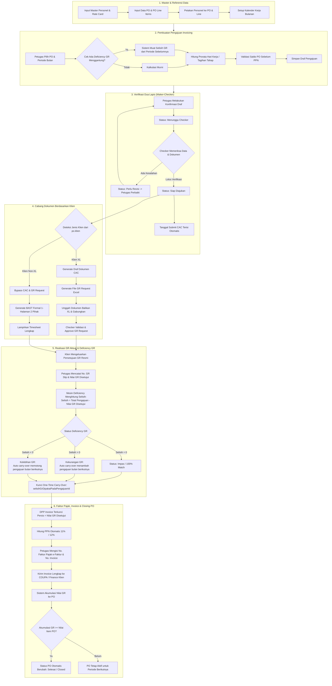
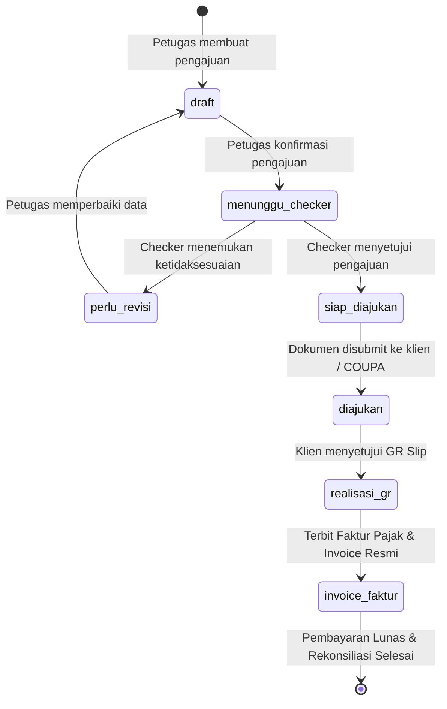

# Alur Operasional & Siklus Hidup Sistem INVORA
**(Invoice Operations & Revenue Assurance)**

Dokumen ini menjelaskan alur operasional software **INVORA** secara menyeluruh dari awal (inisialisasi data master) hingga akhir (penerbitan invoice resmi, penutupan PO, dan rekonsiliasi pembayaran).

---

## Daftar Isi
1. [Peran Pengguna & Hak Akses](#1-peran-pengguna--hak-akses)
2. [Arsitektur Diagram Alur Utama (End-to-End Flowchart)](#2-arsitektur-diagram-alur-utama-end-to-end-flowchart)
3. [Tahap 1: Pengelolaan Master & Data Referensi](#3-tahap-1-pengelolaan-master--data-referensi)
4. [Tahap 2: Pembuatan Draf Pengajuan & Mesin Hitung Otomatis](#4-tahap-2-pembuatan-draf-pengajuan--mesin-hitung-otomatis)
5. [Tahap 3: Verifikasi Dua Lapis (Maker-Checker Workflow)](#5-tahap-3-verifikasi-dua-lapis-maker-checker-workflow)
6. [Tahap 4: Percabangan Proses Berdasarkan Klien (XL vs Non-XL)](#6-tahap-4-percabangan-proses-berdasarkan-klien-xl-vs-non-xl)
   - [Jalur A: Klien XL (CAC & GR Request COUPA)](#jalur-a-klien-xl-proses-cac--gr-request-coupa)
   - [Jalur B: Klien Non-XL (BAST Formal 1 Halaman + Timesheet)](#jalur-b-klien-non-xl-bast-formal-1-halaman--timesheet)
7. [Tahap 5: Pencatatan GR Aktual & Mesin Otomatis Deficiency GR](#7-tahap-5-pencatatan-gr-aktual--mesin-otomatis-deficiency-gr)
8. [Tahap 6: Penerbitan Invoice Resmi & Faktur Pajak](#8-tahap-6-penerbitan-invoice-resmi--faktur-pajak)
9. [Tahap 7: Kontrol Penyelesaian PO (Closing PO) & Rekonsiliasi](#9-tahap-7-kontrol-penyelesaian-po-closing-po--rekonsiliasi)

---

## 1. Peran Pengguna & Hak Akses

INVORA menerapkan pemisahan tugas (*Segregation of Duties / Maker-Checker Principle*):

| Role | Tanggung Jawab Utama | Batasan & Keamanan |
| :--- | :--- | :--- |
| **Super Admin** | Manajemen akun pengguna, data master perusahaan, dan audit log keseluruhan. | Dapat melihat seluruh data dan mengonfigurasi sistem. |
| **Petugas (Maker / Input Data)** | Input & kelola data referensi, buat draf pengajuan, unggah timesheet, generate dokumen CAC/BAST, catat realisasi GR & Faktur Pajak. | **Tidak dapat** menyetujui pengajuannya sendiri (harus dicek oleh Checker). |
| **Checker (Reviewer)** | Memverifikasi kalkulasi prorata/tahap, memeriksa kelengkapan lampiran dokumen, menyetujui/mengembalikan pengajuan (revisi), memvalidasi file GR Request. | **Tidak dapat** mengedit angka langsung tanpa meminta revisi dari Petugas. |

---

## 2. Arsitektur Diagram Alur Utama (End-to-End Flowchart)

---

## 3. Tahap 1: Pengelolaan Master & Data Referensi

Sebelum proses invoicing dimulai, sistem membutuhkan data dasar yang terstandarisasi:

1. **Master Personel & Rate Card:**
   - Menyimpan data talenta (`nama`, `penempatan`).
   - Setiap personel memiliki data *Rate Card* bulanan resmi dengan riwayat tanggal masa berlaku (`berlakuDari`, `berlakuSampai`).
2. **Master PO (Purchase Order) & PO Line Items:**
   - PO bersifat bundling dan dapat menampung banyak talenta.
   - Kolom pokok: `nomorPo`, `namaProyek`, `tahun`, `nilaiItem` (pagu PO sebelum PPN), `saldoSebelumPpn`, `klien` (deteksi XL vs Non-XL), dan `jenisTagihan` (`bulanan` vs `tahap`).
   - Line items: memecah PO per kategori spesialisasi kerja (`nomorLine`, `shortText`, `qty`, `hargaSatuan`).
3. **Pemetaan Personel ke PO:**
   - Menghubungkan personel dengan PO dan PO Line terkait selama periode kontrak tertentu.
4. **Kalender Kerja:**
   - Menetapkan hari kerja resmi, libur nasional, dan cuti bersama setiap bulannya sebagai penyebut (*denominator*) rumus prorata.

---

## 4. Tahap 2: Pembuatan Draf Pengajuan & Mesin Hitung Otomatis

Petugas memilih **Nomor PO**, **User XL/Klien**, dan **Periode Tagihan (YYYY-MM)**. Sistem melakukan kalkulasi di balik layar:

### A. Metode Tagihan Bulanan (Prorata Hari Kerja)
- **Sumber Hitung:**
  - Jika timesheet diunggah: Jumlah hari hadir pada timesheet personel.
  - Jika tanpa timesheet: Dihitung otomatis dari tanggal mulai/selesai kontrak pada bulan berjalan berdasarkan Kalender Kerja.
- **Formula Prorata:**
  $$\text{Nilai Tagihan} = \left(\frac{\text{Hari Kerja Ditagihkan}}{\text{Hari Kerja Acuan Bulan}}\right) \times \text{Rate Bulanan}$$

### B. Metode Tagihan Tahap (Milestone-based)
- Untuk PO bertipe *tahap* (proyek berbasis termin/milestone):
- Tidak menggunakan prorata hari kerja. Petugas memasukkan nominal penagihan secara manual per personel disertai deskripsi tahap (misal: `"Tahap I - 50% UAT"`).

### C. Alokasi Lintas-PO (Cross-PO Allocation)
- Jika plafon saldo sisa PO pertama tidak mencukupi untuk membayar tagihan penuh personel:
  1. Sistem menagihkan sisa saldo maksimal pada PO pertama.
  2. Sisa tagihan yang belum tertampung otomatis ditandai untuk dialokasikan ke PO kedua pada periode yang sama.
  3. Form menyediakan kolom opsional pencatatan approval User XL atas pemecahan lintas-PO ini.

### D. Penyerapan Otomatis Deficiency GR (Carry-Over)
- Sistem memeriksa fungsi `cariSelisihGrMenggantung(poId)`.
- Jika terdapat selisih GR dari pengajuan bulan sebelumnya yang belum terserap, sistem otomatis memunculkan banner peringatan dan memperhitungkan nilai selisih tersebut ke dalam estimasi tagihan akhir.

---

## 5. Tahap 3: Verifikasi Dua Lapis (Maker-Checker Workflow)

Siklus penjaminan kualitas (*Quality Assurance*) tagihan:

1. **Draf Pengajuan:**
   - Petugas memeriksa rincian tabel per personel, alokasi line PO, dan total nilai.
   - Petugas menekan tombol **"Konfirmasi Pengajuan"**.
   - Status berubah menjadi `menunggu_checker`.
2. **Review oleh Checker:**
   - Checker melakukan audit atas hari kerja, rate yang dipakai, kesesuaian dokumen, dan alokasi saldo PO.
   - **Tindakan Checker:**
     - **Minta Revisi (`perlu_revisi`):** Checker memberikan catatan alasan pengembalian. Petugas dapat mengedit kembali data pengajuan.
     - **Setujui (`siap_diajukan`):** Pengajuan disahkan. Sistem otomatis membubuhkan stempel `tanggalSubmitCac` menggunakan tanggal saat Checker meloloskan pengajuan.

---

## 6. Tahap 4: Percabangan Proses Berdasarkan Klien (XL vs Non-XL)

Sistem secara cerdas mendeteksi jenis alur kerja dari nilai `po.klien`:

### Jalur A: Klien XL (Proses CAC & GR Request COUPA)
1. **Draf Dokumen CAC:**
   - Petugas men-generate dokumen CAC (Customer Acceptance Certificate) internal sesuai template XL.
2. **Form GR Request Excel:**
   - Sistem men-generate spreadsheet resmi form pengajuan GR format standar XL.
3. **Siklus Balikan XL:**
   - Petugas mengunggah file balikan dari XL, menggabungkan versi dokumen, dan Checker memvalidasi hasil akhir (`grRequest.dicekPada`).
   - Kolom **Nomor Invoice** terkunci hingga tahap GR Request ini disetujui Checker.

### Jalur B: Klien Non-XL (BAST Formal 1-Halaman + Timesheet)
1. **Bypass CAC & GR Request:**
   - Klien Non-XL tidak menggunakan prosedur CAC atau format Excel GR XL.
2. **Generator Dokumen BAST 1 Halaman:**
   - Sistem menyediakan generator BAST formal 1 halaman lengkap dengan klausul hukum dua pihak:
     - **Pihak Pertama:** Penyedia jasa (PT IDStar Cipta Teknologi).
     - **Pihak Kedua:** Klien penerima jasa (nama instansi, alamat, pejabat berwenang).
   - Menghasilkan PDF resmi siap cetak/tanda tangan basah/elektronik.
3. **Peringatan BAST:**
   - Sistem memberikan indikator peringatan visual jika BAST belum dibuat sebelum pengajuan invoice dilanjutkan.

---

## 7. Tahap 5: Pencatatan GR Aktual & Mesin Otomatis Deficiency GR

Setelah dokumen diserahkan, klien memproses penerbitan Goods Receipt (GR) resmi:

1. **Input Realisasi GR:**
   - Petugas mencatat **Nomor Dokumen GR Slip** (`nomorGrSlip`) dan **Tanggal Disetujui** (`tanggalGrDisetujui`).
   - Petugas menginput **Nilai GR Aktual yang Disetujui** (`nilaiGrDisetujui`) sebelum PPN.
2. **Evaluasi Selisih (Deficiency GR):**
   $$\text{Selisih GR} = \text{Total Tagihan Pengajuan} - \text{Nilai GR Disetujui}$$
   - **Impas (`0.00`):** Nilai GR disetujui sama persis dengan yang diajukan.
   - **Kekurangan GR ($> 0$):** Klien menyetujui lebih kecil dari nilai pengajuan. Nilai selisih positif otomatis di-carry over untuk **menambah** tagihan pengajuan berikutnya.
   - **Kelebihan GR ($< 0$):** Klien menyetujui lebih besar dari nilai pengajuan. Nilai selisih negatif otomatis di-carry over untuk **memotong** tagihan pengajuan berikutnya.
3. **Garansi One-Time Carry-Over:**
   - Ketika selisih diserap oleh pengajuan baru, kolom `selisihGrDipakaiPadaPengajuanId` pada pengajuan lama langsung diisi ID pengajuan baru tersebut.
   - Ini menjamin selisih tidak akan pernah terbawa dua kali dalam audit keuangan.

---

## 8. Tahap 6: Penerbitan Invoice Resmi & Faktur Pajak

1. **Penguncian Nilai Invoice (Dasar Pengenaan Pajak / DPP):**
   - Mengikuti regulasi perpajakan dan aturan BRD: **Nilai Invoice sebelum PPN wajib sama persis dengan Nilai GR Disetujui**.
2. **Kalkulasi Pajak Otomatis:**
   - **Tarif PPN:** Dapat dipilih 11% (UU HPP) atau 12% (penyesuaian regulasi baru).
   - $\text{PPN} = \text{DPP} \times \text{Tarif PPN}$
   - $\text{Total Invoice Resmi} = \text{DPP} + \text{PPN}$
3. **Pencatatan e-Faktur:**
   - Petugas mencatat **Nomor Faktur Pajak** resmi dari DJP (`nomorFakturPajak`) dan **Tanggal Faktur Pajak**.
4. **Pencatatan Nomor Invoice Perusahaan:**
   - Petugas memasukkan nomor urut invoice terpusat perusahaan (`nomorInvoice`).

---

## 9. Tahap 7: Kontrol Penyelesaian PO (Closing PO) & Rekonsiliasi

1. **Pembaruan Akumulasi Realisasi GR:**
   - Setiap kali nilai GR disetujui dicatat atau diubah, sistem menghitung ulang total kumulatif realisasi GR pada tabel PO (`po.nilaiGr`).
2. **Otomatisasi Status Closing PO:**
   - Sistem membandingkan:
     $$\text{Total Realisasi GR} \ge \text{Nilai Pagu Item PO}$$
   - Jika kondisi terpenuhi, sistem otomatis mengubah `statusPo` menjadi **`selesai` (Closed)**.
   - Jika belum terpenuhi, status PO tetap **`aktif`**.
3. **Tampilan Monitoring Eksekutif:**
   - **Tabel PO:** Menampilkan badge `Aktif` / `Selesai (Closed)`.
   - **Halaman Summary PO (`/summary-po`):** Memantau pergerakan saldo sisa PO per tahun secara real-time.
   - **Analisa Durasi Invoicing (`/dashboard/analisa-durasi`):** Melacak durasi rata-rata siklus penagihan (CAC disetujui $\rightarrow$ GR disetujui $\rightarrow$ Invoice lunas).
   - **Rekon Invoice (`/api/rekon-invoice`):** Mencocokkan status penagihan internal dengan catatan pembayaran finance.

---

## Ringkasan Transisi Status Pengajuan

