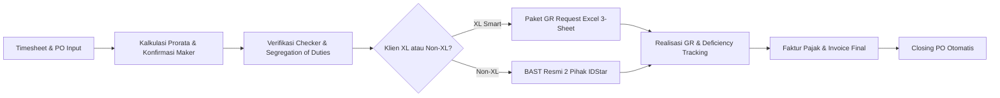

# INVORA (Invoice Operations & Revenue Assurance)
## Project Executive & Technical Summary

**Perusahaan:** PT IDStar Cipta Teknologi  
**Aplikasi:** INVORA (Sistem Manajemen Invoicing, BAST, GR Tracking, & Revenue Assurance)  
**Tanggal Rilis Dokumen:** 21 Oktober 2026  
**Status Pengembangan:** **MVP 1 – MVP 4 Selesai Penuh (Production Ready)**  
**Repositori:** [imamfatah-idstar/Invora](https://github.com/imamfatah-idstar/Invora)  
**Platform Deployment:** Vercel (Production) & Supabase PostgreSQL  

---

## 1. Executive Summary

**INVORA** adalah sistem enterprise internal PT IDStar Cipta Teknologi yang dirancang khusus untuk mengelola end-to-end siklus penagihan (*invoicing*), rekonsiliasi hari kerja talenta (*timesheet*), pembuatan berkas BAST/CAC resmi, pertukaran paket *Goods Receipt (GR) Request* dengan klien (khususnya XL Smart & Non-XL), penanganan selisih persetujuan (*Deficiency GR*), hingga penerbitan Faktur Pajak dan *Closing Purchase Order (PO)*.

Sistem ini mentransformasikan proses penagihan manual berbasis spreadsheet yang rentan selisih hitung menjadi platform terpadu dengan kepatuhan tata kelola ketat (*Maker-Checker Segregation of Duties*), kalkulasi prorata presisi (*Decimal.js*), dan keamanan korporat (*Google Workspace SSO `@idstar.group`*).



---

## 2. Latar Belakang & Masalah Bisnis yang Diselesaikan

| Tantangan Sebelumnya | Solusi INVORA |
|---|---|
| **Human Error Prorata Hari Kerja:** Talenta bergabung atau keluar di tengah bulan sering salah hitung jam/hari kerja dapat ditagihkan. | **Automated Working Day Engine:** Terintegrasi kalender kerja resmi IDStar & Indonesia, menghitung prorata hari kerja dengan presisi desimal tanpa pembulatan liar. |
| **Penyalahgunaan Wewenang (Tanpa Segregation):** Satu orang bisa membuat dan menyetujui tagihan sekaligus. | **Sistem Maker-Checker Berbasis Server:** Pembuat pengajuan (*Petugas*) diblokir keras oleh sistem untuk menyetujui pengajuannya sendiri. Hanya akun berwenang (*Checker*) yang bisa meloloskan. |
| **Kelebihan Tagihan Lintas PO (Cross-PO):** Nilai tagihan melebihi sisa plafon PO aktif harus dipisah manual. | **Alur Cross-PO Otomatis (MVP 2):** Sistem otomatis memecah porsi tagihan yang melampaui saldo PO utama dan mengalokasikannya ke PO penerus secara berantai. |
| **Paket GR Request XL yang Rumit:** Tim finance XL mewajibkan format file Excel 3-sheet (*Vendor, SOW, COVER*) yang harus bolak-balik direvisi. | **Automated Excel Package Engine (MVP 3):** Generate sheet Vendor otomatis via ExcelJS, fitur upload balikan XL, merge cerdas, serta audit riwayat versi. |
| **Deficiency GR (Persetujuan Parsial Klien):** Klien menyetujui GR lebih kecil dari nilai BAST/CAC karena selisih evaluasi internal. | **Deficiency GR Engine (MVP 4):** Menghitung selisih GR secara otomatis, menerapkan garansi *One-Time Carry-Over* ke pengajuan berikutnya pada PO yang sama, serta mengunci nilai riil tagihan. |
| **Format Dokumen Tidak Seragam (Multi-Klien):** Klien Non-XL membutuhkan BAST resmi 2 pihak, bukan berkas CAC internal XL. | **Multi-Client Architecture:** Deteksi otomatis tipe klien. Non-XL langsung diarahkan ke BAST formal 1 halaman dua pihak dengan penyesuaian nama PIC & tanda tangan. |
| **Akses Tak Terotorisasi:** Penggunaan akun non-korporat pada data finansial sensitif. | **Google SSO Domain Lockdown:** Hanya akun dengan domain resmi `@idstar.group` yang dapat login melalui Google OAuth. |

---

## 3. Rangkuman Pencapaian Fitur per Tahap (Milestone)

### MVP 1 — Pondasi Penagihan, Prorata, & CAC (Selesai)
- **Role-Based Access Control (RBAC):** Pemisahan hak akses antara `administrator`, `petugas` (Maker), dan `checker` (Reviewer).
- **Kalkulasi Prorata Hari Kerja:** Perhitungan otomatis berdasarkan data absensi (*timesheet*) dan *rate card* harian talenta.
- **Generator Dokumen CAC/BAST PDF:** Pembuatan otomatis dokumen CAC/BAST PDF standar ber-stempel dan bertanda tangan digital.
- **Audit Trail & Jejak Riwayat:** Pencatatan log aktivitas pengajuan untuk transparansi operasional.

### MVP 2 — Penanganan Lintas PO (Cross-PO) (Selesai)
- **Otomasi Pemecahan Tagihan:** Jika plafon PO tidak mencukupi untuk seluruh talenta dalam suatu periode, sisa tagihan dialokasikan ke PO tujuan secara mulus.
- **Pencatatan Berantai (>2 PO):** Mendukung pemindahan alokasi ke beberapa PO lanjutan jika proyek memiliki rangkaian amandemen kontrak.
- **Pencatatan Persetujuan User XL:** Logging internal tanggal approval dari PIC klien.

### MVP 2b — Fondasi Operasional & Manajemen Data (Selesai)
- **Summary PO Dashboard:** Ringkasan komprehensif pagu PO, realisasi terpakai, dan sisa saldo per tahun anggaran.
- **Timesheet sebagai Dasar Penagihan:** Validasi hari kerja berdasarkan data aktual talenta.
- **Impor Massal Excel & Tracker:** Impor data PO massal, rate card personel, dan klien langsung dari spreadsheet tracker resmi.
- **Fitur Rekon Invoice:** Laporan rekap penagihan untuk rekonsiliasi akuntansi bulanan.

### MVP 3 — Paket Request GR XL Smart (Selesai)
- **Ekspor Excel 3-Sheet:** Pembuatan file `.xlsx` otomatis dengan struktur sheet *Vendor*, *SOW*, dan *COVER* sesuai standar vendor XL Smart.
- **Siklus Bolak-Balik Tim XL:** Mekanisme unggah ulang berkas hasil koreksi/isi dari tim XL dengan validasi struktur sheet.
- **Gate Checker Ketat:** Pengisian nomor invoice dikunci (*locked*) sebelum berkas GR Request diperiksa dan disetujui oleh Checker.
- **Versioning Berkas:** Penyimpanan riwayat versi GR Request per pengajuan untuk mencegah data tertimpa tanpa jejak.

### Multi-Klien & BAST Non-XL (Selesai)
- **Deteksi Cerdas Tipe Klien:** Klasifikasi otomatis dari nama klien pada master PO (`XL` vs `Non-XL`).
- **Bypass Alur XL:** Proyek Non-XL otomatis melewati langkah CAC dan paket GR Request 3-sheet XL.
- **BAST Formal 1 Lembar:** Dokumen Berita Acara Serah Terima Pekerjaan 2 pihak resmi (PT IDStar Cipta Teknologi & Klien) lengkap dengan nomor BAST, dasar kontrak/PO, tabel talenta/milestone, dan kolom tanda tangan kedua belah pihak.
- **Badge & Alert Reminder:** Notifikasi visual di antarmuka jika BAST Non-XL belum diunduh/ditandatangani.

### MVP 4 — Realisasi GR Aktual, Deficiency GR, & Faktur Pajak (Selesai)
- **Pencatatan Slip GR:** Input Nomor GR Slip dan Nilai GR yang disetujui klien.
- **Deficiency GR Engine:**
  $$\text{Selisih GR} = \text{Nilai Pengajuan (sebelum PPN)} - \text{Nilai GR Disetujui}$$
- **One-Time Carry-Over Rule:** Selisih minus GR dapat dikompensasikan (*carry-over*) tepat satu kali ke pengajuan bulan berikutnya pada PO yang sama untuk menjaga akurasi pembukuan.
- **Live Invoice & Tax Calculation:** Perhitungan dinamis nilai tagihan kotor, penyesuaian selisih, PPN (default 11%), nomor faktur pajak, dan tanggal faktur pajak.
- **Closing PO Otomatis:** Perubahan status PO menjadi `selesai` secara otomatis saat kumulatif nilai GR telah menyerap seluruh nilai pagu PO.

### Google SSO & Peningkatan Keamanan Korporat (Selesai)
- **Google Workspace OAuth2:** Login 1-klik menggunakan akun Google.
- **Strict Domain Whitelisting:** Validasi ketat pada backend dan callback; hanya email berakhiran `@idstar.group` yang diizinkan masuk.
- **Pembersihan Tampilan Login:** Tampilan form login modern, bersih, bebas footer yang mendistraksi, dengan visual elegan.

---

## 4. Arsitektur Teknis & Teknologi

```
+-------------------------------------------------------------------------+
|                              FRONTEND                                   |
|   Next.js 16 (App Router, Turbopack) + React 19 + Tailwind CSS / Vanilla|
|   Komponen: StatusProsesForm, BastNonXlView, SummaryPO, PengajuanClient |
+-------------------------------------------------------------------------+
                                    │
                                    ▼
+-------------------------------------------------------------------------+
|                               BACKEND                                   |
|   Next.js API Routes (Server Actions & Route Handlers)                  |
|   Business Logic: src/lib/deficiency-gr.ts, klien.ts, google-auth.ts    |
|   PDF & Spreadsheet Engines: pdf-lib (Stamping) + ExcelJS               |
+-------------------------------------------------------------------------+
                                    │
                                    ▼
+-------------------------------------------------------------------------+
|                           DATABASE LAYER                                |
|   Drizzle ORM 0.45.2 (Schema migrations, type-safe queries)             |
|   PostgreSQL Hosted on Supabase (Row-Level Security / RLS terpasang)    |
+-------------------------------------------------------------------------+
```

### Stack Spesifikasi:
- **Framework:** Next.js 16.3.5 (Turbopack, Server Components)
- **Bahasa:** TypeScript 5.x
- **UI & Komponen:** React 19, Tailwind CSS, Lucide React Icons
- **Database ORM:** Drizzle ORM dengan driver `postgres` (PostgreSQL)
- **Basis Data:** Supabase PostgreSQL Cloud
- **Pengolahan Dokumen:**
  - `pdf-lib` & `@pdf-lib/fontkit`: Komposisi dan pencetakan PDF resmi (BAST & CAC)
  - `exceljs`: Pembuatan, parsing, dan manipulasi template spreadsheet multi-sheet
- **Presisi Perhitungan Finansial:** `decimal.js` untuk mencegah floating point rounding error pada mata uang Rupiah
- **Otentikasi:** Kredensial lokal terenkripsi + Google Workspace OAuth2 API

---

## 5. Ringkasan Skema Basis Data Inti

| Tabel | Deskripsi | Atribut Kunci Baru |
|---|---|---|
| `po` | Master Purchase Order klien | `nomor_po`, `klien`, `nilai_item`, `saldo_sebelum_ppn`, `status_po` (`aktif` / `selesai`) |
| `po_line_item` | Rincian baris pekerjaan dalam PO | `nomor_line_item`, `short_text`, `posisi`, `rate_bulanan`, `rate_harian` |
| `pengajuan` | Entitas induk pengajuan penagihan | `jenis_pengajuan`, `status`, `nomor_invoice`, `nomor_gr_slip`, `nilai_gr_disetujui`, `selisih_gr`, `selisih_gr_dipakai_pada_pengajuan_id`, `penyesuaian_selisih_gr_masuk`, `nomor_faktur_pajak`, `tanggal_faktur_pajak`, `tarif_ppn` |
| `pengajuan_detail` | Rincian personel/tahap per pengajuan | `personel_id`, `po_line_item_id`, `hari_kerja_dapat_ditagihkan`, `nilai_ditagihkan` |
| `gr_request_riwayat` | Versi berkas GR Request XL | `pengajuan_id`, `versi`, `nama_file`, `path_file`, `created_at` |
| `pengguna` | Akun pengguna sistem | `email`, `role` (`administrator`, `petugas`, `checker`), `google_id` |

---

## 6. Dataset Dummy & Kesiapan Pengujian

Sistem telah dilengkapi dengan *seeding script* data dummy komprehensif (`scripts/seed-data-bervariasi.ts`) yang merefleksikan skenario nyata operasional IDStar:

- **8 Purchase Order (PO):**
  - Rentang tahun 2025 s/d 2026.
  - Klien variatif: XL Axiata (Smartfren merge), Bank Mandiri, Telkomsel, Astra International.
  - Nilai kontrak bervariasi dari puluhan juta hingga miliaran rupiah.
- **16 Talenta & Rate Card:** Beragam peran (Senior Fullstack Developer, SAP Consultant, QA Automation, DevOps Engineer, Business Analyst).
- **13 Pengajuan dengan Spektrum Status Lengkap:**
  1. *Draft / Konfirmasi Petugas*
  2. *Menunggu Review Checker*
  3. *Perlu Revisi (Catatan Checker)*
  4. *Disetujui Checker (Siap Proses GR/BAST)*
  5. *Paket GR Request XL Terunggah*
  6. *GR Aktual Disetujui Penuh (100%)*
  7. *GR Disetujui dengan Deficiency GR (Selisih dipotong)*
  8. *Pengajuan Baru yang Mengklaim Carry-Over Selisih GR Sebelumnya*
  9. *Pengajuan Non-XL dengan BAST Formal 2 Pihak*
  10. *PO Selesai (Fully Absorbed / Closed)*

---

## 7. Roadmap Selanjutnya (MVP 5)

| Fitur | Deskripsi | Target Status |
|---|---|---|
| **Monitoring Outstanding Invoicing** | Pelacakan tagihan yang sudah terbit invoice namun belum dibayar klien berdasarkan batas waktu (*aging invoice*). | Perencanaan |
| **Pencatatan Pembayaran (Payment Settlement)** | Input tanggal pelunasan, nomor bukti potong PPh 23, dan rekening bank penampung. | Perencanaan |
| **Jadwal Bayar Berdasarkan Approval COUPA/Portal Klien** | Estimasi tanggal cair otomatis berbasis Term of Payment (TOP 30/45/60 hari) sejak tanggal approval portal klien. | Perencanaan |
| **Email Reminder Otomatis** | Pengiriman rekap invoice jatuh tempo terjadwal (misal: setiap Senin pukul 09.00 WIB) ke Finance Klien / Account Manager IDStar. | Perencanaan |

---

## 8. Kesimpulan

INVORA telah berhasil menyelesaikan implementasi fungsional dari **MVP 1 hingga MVP 4** beserta penyesuaian operasional **Multi-Klien (BAST Formal)** dan integrasi **Google Workspace Single Sign-On**. Aplikasi telah teruji secara komprehensif melalui *type-checking*, build production Next.js 16, dan simulasi alur end-to-end dengan dataset realistis. INVORA siap digunakan untuk mendukung kelancaran arus kas (*cash flow*) dan kepastian pendapatan (*revenue assurance*) PT IDStar Cipta Teknologi.
